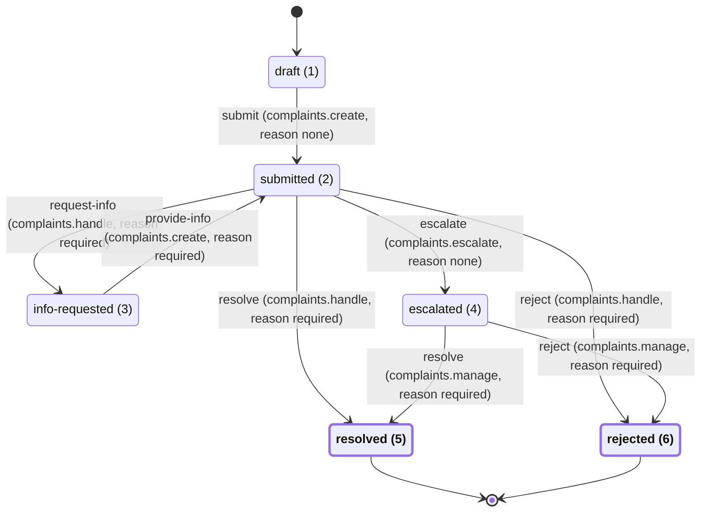

# Complaint

## Scenario

> Citizens file a complaint about one of our services and can follow it; a complaints officer resolves it with a
> response or rejects it with a reason, and can ask the citizen for more information; a complaint still open 10 days
> after it was filed escalates to the complaints manager.

From the BRD (brd-complaint.md (`tools/pipeline-proofs/inputs/complaint/brd-complaint.md`)):

> 1. A citizen files a complaint in a short multi-step form: the service concerned (from a reference list of
>    services), a complaint category (from a reference list: delay, staff conduct, wrong decision, other), a subject
>    (at most 150 characters), a description (at most 2000 characters) and an optional supporting file. The last step
>    shows everything for review before the complaint is submitted. The citizen may save a draft and come back.

- A **citizen** (requester side, signed in) fills the wizard and submits; the record gets a number `CMP-<year>-<n>`
  that the wizard shows at once (BRD 2).
- A **complaints officer** (staff side) picks the complaint from the work queue (claim through the Assignments
  module) and **resolves** it with a written response or **rejects** it with a reason; either text is required
  (BRD 3).

> 3. ... either **resolves** it with a written response to the citizen, or **rejects** it with a reason ... A response
>    or a reason is always required.

- The officer may **ask the citizen for more information** with a question; the complaint waits for the citizen, who
  answers once, and the complaint returns to the queue (BRD 4).

> 4. The officer may **ask the citizen for more information** with a question; the complaint then waits for the
>    citizen, who answers once and the complaint returns to the queue.

- A complaint neither resolved nor rejected **10 days** after it was submitted is **escalated** to the **complaints
  manager**, who resolves or rejects it (BRD 5).

> 5. A complaint that is neither resolved nor rejected **10 days** after it was submitted is **escalated** to the
>    complaints manager, who then resolves or rejects it.

- Citizens see only their own complaints; officers and the manager see all (BRD 6). Every status change with actor
  and time is on the timeline (BRD 7, the Records timeline). Arabic and English everywhere (BRD 8).
- Out of scope (BRD): anonymous complaints, satisfaction surveys, other complaint channels.

### Open decisions (assumptions taken in this unattended run)

1. **Clock during an information request.** The Deadlines engine times one status from entry; leaving and
   re-entering a status starts a new deadline. The SLA is on Submitted: while the complaint waits for the citizen
   (InfoRequested) the clock stops, and the answer starts a **new** 10-day timer. For a complaint with an information
   request this deviates from BRD 5 ("10 days after it was submitted"); without one it is exact. Alternative for the
   approver: keep one timer from the first submission (needs a Deadlines engine change, not planned).
2. **Automatic escalation on the breach.** The Deadlines scan only notifies today. Moving the record to Escalated uses
   the Deadlines "another reaction to a breach" extension point (`SlaEscalations.EscalateOneAsync`, behind a kernel
   port that the Complaints module implements, keeping claim-before-act), and the Records engine needs a way to run a
   `System`-side transition as SYSTEM (none exists: `RecordStanding` has only Requester and Staff sides). Both are
   **expected hand edits** (Deadlines, Records, the kernel port in `Starter.Application`) and will be logged in the
   Hand-edit log.
3. **Escalated is not timed.** No SLA on Escalated (the BRD gives none); the manager sees it in the queue with the
   escalation notification.
4. **One answer per question.** `provide-info` leaves InfoRequested, so each question gets exactly one answer; the
   officer may ask again after the complaint is back in Submitted.
5. **No cancel and no withdrawal.** The BRD names none; a draft that is never submitted simply stays a draft.
6. **Field minimums** (BRD gives maximums only): subject 5 to 150 characters, description 20 to 2000 characters
   (the sample's minimums).
7. **Wizard steps.** Four steps, to match the four-step stepper of the target images: 1 service and category,
   2 subject and description, 3 supporting file, 4 review. The target images come from the starter showcase wizard
   (generic labels); the stepper, field layout and action bar are matched, the texts are the complaint's.
8. **Supporting file.** Attachment type id 4, key `complaint-supporting`, optional, at most 1 file, `.pdf`, `.jpg`,
   `.png`; the maximum size follows the Attachments module default (the BRD gives none).
9. **My complaints route.** The sample's shape: the list at `/complaints/mine`, the draft resume at
   `/complaints/drafts/:id`; `/complaints` redirects to `/complaints/mine` (no requester dashboard for complaints).
10. **Reference lists.** Services (fictional): `licensing`, `certificates`, `inspections`, `customer-service`,
    `e-services`; categories: `delay`, `staff-conduct`, `wrong-decision`, `other`. Arabic is the primary language
    (BRD 8), so the build writes Arabic wording for every text (lookup names below, status wording, action labels,
    field labels, notification templates) in plain Modern Standard Arabic; the business may refine the wording later
    through the i18n files and new seed migrations.
11. **The manager also holds `complaints.queue`** and sees all complaints in the queue; officers do not see an
    escalated complaint's decision buttons (they lack `complaints.manage`).

## Inputs

- The scenario sentence (front matter, quoted above).
- tools/pipeline-proofs/inputs/complaint/brd-complaint.md (`tools/pipeline-proofs/inputs/complaint/brd-complaint.md`):
  actors (citizen, officer, manager), the wizard fields and limits (requirement 1), the number (2), the decisions and
  required texts (3), the information request (4), the 10-day escalation (5), visibility (6), timeline (7), languages
  (8), the three screens and the out-of-scope list.
- Target images `tools/pipeline-proofs/inputs/complaint/target.ar.1440.png`, `target.ar.390.png`,
  `target.en.1440.png`, `target.en.390.png`: the multi-step wizard look (stepper with four steps, step counter,
  field layout, action bar with Cancel, Back, Save draft, Next) for `/complaints/new`, Arabic and English, desktop
  1440 px and mobile 390 px.
- `tools/pipeline-proofs/inputs/complaint/masks.json`: the visual route `complaint-new` at `/complaints/new` and the
  masks `.shell__brand`, `.footer__brand`, `[data-visual-mask]` (branding and dynamic text).

## Modules

- **New module `Complaints`** (new-module), built from the sample by the
  add-workflow-type recipe (`docs/recipes/add-workflow-type.md`):

  | Name | Value |
  | --- | --- |
  | Module (PascalCase plural) | Complaints |
  | Entity (singular) | Complaint |
  | Record type key | complaint |
  | Number prefix | CMP |
  | Permission prefix | complaints |
  | i18n prefix | complaints |
  | Frontend area | features/complaints |
  | Schema / table | complaints.Complaints |

  Own table `complaints.Complaints`: `RecordId` (the Records record id, by value only), `ServiceId` and `CategoryId`
  (lookup PublicId tokens on the wire), `Subject` (max 150), `Description` (max 2000); all nullable while a draft.
  Rules (`ComplaintRules`, mirrored by the client with a parity fixture): service present and active, category
  present and active, subject 5 to 150, description 20 to 2000. Validation codes `COMPLAINTS_{SERVICE_REQUIRED,
  SERVICE_UNKNOWN, CATEGORY_REQUIRED, CATEGORY_UNKNOWN, SUBJECT_REQUIRED, SUBJECT_TOO_SHORT, SUBJECT_TOO_LONG,
  DESCRIPTION_REQUIRED, DESCRIPTION_TOO_SHORT, DESCRIPTION_TOO_LONG, STEP_INVALID}`; conflict
  `COMPLAINTS_NOT_EDITABLE`.
- **Attachment type** declared in the module (`ComplaintAttachmentTypes`, `IAttachmentTypeSeedSource`, recipe
  add-attachment-type (`docs/recipes/add-attachment-type.md`)): id 4 `AttachmentTypeIds.ComplaintSupporting`, key
  `complaint-supporting`, optional, at most 1 file, `.pdf`, `.jpg`, `.png`, attachable record type `complaint`; the
  owner may change it while Draft.
- **Lookups** (seed migrations in the Lookups module, new-lookup): `complaint-services` and `complaint-categories`.

  | Lookup | Id | Key | en | ar |
  | --- | --- | --- | --- | --- |
  | complaint-services | 1 | licensing | Licensing | التراخيص |
  | complaint-services | 2 | certificates | Certificates | الشهادات |
  | complaint-services | 3 | inspections | Inspections | التفتيش |
  | complaint-services | 4 | customer-service | Customer service | خدمة العملاء |
  | complaint-services | 5 | e-services | E-services | الخدمات الإلكترونية |
  | complaint-categories | 1 | delay | Delay | تأخير |
  | complaint-categories | 2 | staff-conduct | Staff conduct | سلوك الموظفين |
  | complaint-categories | 3 | wrong-decision | Wrong decision | قرار غير صحيح |
  | complaint-categories | 4 | other | Other | أخرى |

- **Notifications** (seed migration in the Notifications module, add-notification recipe (`docs/recipes/add-notification.md`)):
  templates `complaints.submitted`, `.info-requested`, `.info-provided`, `.resolved`, `.rejected`, `.escalated`,
  `.sla-escalation`, Arabic and English, in-app and e-mail; placeholder `{{recordNumber}}` (plus `{{dueAt}}` in
  the SLA escalation). Keys: `ComplaintNotificationKeys`.
- **Deadlines** and **Records**: the expected hand edits of open decision 2 (breach reaction port, System-side
  transition as SYSTEM). **Assignments**: no change (claim, release, assign reused).

Statuses (explicit int values, never renumbered): Draft 1, Submitted 2, InfoRequested 3, Escalated 4, Resolved 5,
Rejected 6. Initial: Draft. Terminal: Resolved 5, Rejected 6. Status keys `draft`, `submitted`, `info-requested`,
`escalated`, `resolved`, `rejected`.

## Statuses and transitions

| From | Action | To | Permission | Reason required |
| --- | --- | --- | --- | --- |
| draft (1) | submit | submitted (2) | complaints.create | no |
| submitted (2) | request-info | info-requested (3) | complaints.handle | yes |
| submitted (2) | resolve | resolved (5) | complaints.handle | yes |
| submitted (2) | reject | rejected (6) | complaints.handle | yes |
| submitted (2) | escalate | escalated (4) | complaints.escalate | no |
| info-requested (3) | provide-info | submitted (2) | complaints.create | yes |
| escalated (4) | resolve | resolved (5) | complaints.manage | yes |
| escalated (4) | reject | rejected (6) | complaints.manage | yes |

The 8 transitions of the draft are kept unchanged (same from, action, to, permission and reason); only the notation
(status key and stored value) and the row order (grouped by from-status, as the generated sheet lists them) changed.

### Transition details

| From | Action | Side | Owner only | Reason | Reason field | Notification |
| --- | --- | --- | --- | --- | --- | --- |
| draft (1) | submit | requester | yes | none | - | complaints.submitted to requester |
| submitted (2) | request-info | staff | no | required | reason | complaints.info-requested to requester |
| submitted (2) | resolve | staff | no | required | reason | complaints.resolved to requester |
| submitted (2) | reject | staff | no | required | reason | complaints.rejected to requester |
| submitted (2) | escalate | system | no | none | - | complaints.escalated to assignee |
| info-requested (3) | provide-info | requester | yes | required | reason | complaints.info-provided to assignee |
| escalated (4) | resolve | staff | no | required | reason | complaints.resolved to requester |
| escalated (4) | reject | staff | no | required | reason | complaints.rejected to requester |

The reason field is `reason` on every rule that requires it (the kernel's single reason field, as in the sample); the
dialog labels it per action: the response (resolve), the rejection reason (reject), the question (request-info), the
citizen's answer (provide-info). Labels `complaints.action.<actionKey>` (ar and en); resolve and reject share one label
from both statuses. Staff rules are never offered to the record's owner (the engine's segregation of duties).

**Notification decisions use only what the kernel offers.** `NotificationDecision` has exactly two recipients,
`NotifyRequester` and `NotifyAssignee` (or `None`); there is no "queue" and no "holders of a permission" recipient.
Changes from the draft's wording:

- `submit`: the draft said "queue". The only real options are requester or assignee, and a just-submitted complaint
  has no assignee, so the decision is **to requester** (the confirmation with the `CMP-` number, as in the sample).
  The queue learns of new complaints from the work queue itself, not from a notification.
- `provide-info`: the draft said "assignee or queue". The decision is **to assignee**; when the complaint is
  unassigned at that moment, nobody is notified (the kernel skips an absent assignee) and it shows in the queue.
- `escalate`: the draft said "holders of complaints.manage", which is not a kernel option. The closest real option is
  **to assignee** (the staff recipient; it tells the officer who held the complaint that it has moved to the
  manager). The manager is reached by the SLA escalation notification `complaints.sla-escalation` of the Deadlines
  scan, which goes to the assignee or, while the complaint is unassigned, to every holder of the queue permission
  `complaints.queue` (the manager holds it, open decision 11), and by the Escalated status in the queue. **Gap for the
  approver:** when an officer has claimed the complaint, neither notification reaches the manager. Fix options: the
  breach reaction (open decision 2) releases the assignment before it runs `escalate`, or a new Notifications
  recipient "holders of a permission" (kernel change). **Decided (orchestrator, unattended run):** neither. Releasing
  the assignment would not reach the manager either (the Deadlines `IPermissionHolderDirectory` has no implementation
  yet, so an unassigned breach notifies no one), and a new recipient kind is a kernel change outside this feature.
  The manager works escalated complaints from the work queue (status Escalated, SLA badge Breached); a manager
  notification is a follow-up once the kernel has a permission-holder recipient.

**The System-side rule (`escalate`).** `TransitionCatalogValidator` accepts a `TransitionSide.System` rule: it does
not check the side at all, and treats its permission like any other (it must be non-blank and a key of the permission
catalog, so `complaints.escalate` must be declared by `new-permission` first; no role holds it). The engine
(`RecordWorkflowEngine.Decide`) permits it only to a caller whose standing is on the System side and holds
`complaints.escalate`, so no requester or staff screen is ever offered it and a Requester or Staff call is refused
`Forbidden` (the kernel `RecordWorkflow` already accepts a `WorkflowActor` with `TransitionSide.System`). What the
engine lacks to run it (open decision 2): the Records module derives a caller's side only as Requester or Staff
(`RecordStanding.Side`) and has no entry that commits a transition as the SYSTEM actor, so nothing can take this rule
until the Records and Deadlines hand edits add that entry and the breach reaction.

### Statuses

| Value | Key | Initial | Terminal | Wording keys (requester, staff, admin) | Wording en (requester; staff; admin) | Wording ar |
| --- | --- | --- | --- | --- | --- | --- |
| 1 | draft | yes | no | complaints.status.draft.* | Draft; Draft; Draft | open (open decision 10) |
| 2 | submitted | no | no | complaints.status.submitted.* | Under review; Awaiting decision; Submitted | open (open decision 10) |
| 3 | info-requested | no | no | complaints.status.info-requested.* | Information needed from you; Waiting for the citizen; Information requested | open (open decision 10) |
| 4 | escalated | no | no | complaints.status.escalated.* | Escalated to the complaints manager; Escalated to the manager; Escalated | open (open decision 10) |
| 5 | resolved | no | yes | complaints.status.resolved.* | Resolved; Resolved; Resolved | open (open decision 10) |
| 6 | rejected | no | yes | complaints.status.rejected.* | Rejected; Rejected; Rejected | open (open decision 10) |

`*` is `requester`, `staff` or `admin` (`complaints.status.<statusKey>.<requester|staff|admin>`). The Arabic wording
is not invented here: the build writes it in plain Modern Standard Arabic (open decision 10) and the client reviews it
on the sign-off sheet. SLA: only submitted (2) carries one (10 days, due soon 2 days, `complaints.sla-escalation`;
see Deadlines); info-requested and escalated are not timed (open decisions 1 and 3); terminal statuses never are.

Validator check (by hand against `TransitionCatalogValidator`): one initial status (draft); every status reachable
from draft (submitted by submit; info-requested, escalated, resolved, rejected from submitted); no rule out of
resolved or rejected; no action declared twice from one status (resolve and reject each appear once from submitted
and once from escalated); every required reason has the field `reason`; every permission (`complaints.create`,
`.handle`, `.manage`, `.escalate`) is in the Permissions table; every rule has a notification decision with a template
exactly when someone is notified.

### new-transition runs

The add-workflow-type recipe (step 5, Skill plan item 1) writes the starting catalog by hand: draft (1, initial),
submitted (2) and the `submit` rule (the Records module needs a submit rule out of the initial status), requester,
owner only, reason none, `--notify requester --template complaints.submitted`. The permissions come first
(`new-permission`). Then, in this order (each `--from` exists; each new status is created with the transition into it
and gets the next free value, so the values come out 3, 4, 5, 6). Every run adds `--module Complaints --i18n-prefix
complaints`; `--status-ar` and `--label-ar` take the Arabic written per open decision 10.

1. `--status info-requested --action request-info --from submitted --to info-requested --permission complaints.handle --side staff --reason required --notify requester --template complaints.info-requested`
2. `--action provide-info --from info-requested --to submitted --permission complaints.create --side requester --owner --reason required --notify assignee --template complaints.info-provided`
3. `--status escalated --action escalate --from submitted --to escalated --permission complaints.escalate --side system --reason none --notify assignee --template complaints.escalated`
4. `--status resolved --terminal --action resolve --from submitted --to resolved --permission complaints.handle --side staff --reason required --notify requester --template complaints.resolved`
5. `--action resolve --from escalated --to resolved --permission complaints.manage --side staff --reason required --notify requester --template complaints.resolved`
6. `--status rejected --terminal --action reject --from submitted --to rejected --permission complaints.handle --side staff --reason required --notify requester --template complaints.rejected`
7. `--action reject --from escalated --to rejected --permission complaints.manage --side staff --reason required --notify requester --template complaints.rejected`

After the build, `docs/generated/workflows/complaint.md` must show exactly this diagram and these 8 rules; any
difference is reported before the commit gate.

## Deadlines

| Status | Duration | Due soon before | Escalation template |
| --- | --- | --- | --- |
| Submitted | 10 days | 2 days | complaints.sla-escalation |

Declared as an `ISlaPolicySource` in `Complaints` (add-deadline recipe (`docs/recipes/add-deadline.md`)). On the
breach the reaction runs `escalate` as SYSTEM (open decisions 1 and 2): the clock stops in InfoRequested and the
answer opens a new 10-day deadline.

## Permissions

| Key | Allows | Expected holder |
| --- | --- | --- |
| complaints.create | create, edit and submit own drafts; answer an information request (provide-info) | citizen |
| complaints.view-own | list and open own complaints and their timeline | citizen |
| complaints.queue | see the work queue and complaint details | officer, manager |
| complaints.handle | resolve, reject or request information on a submitted complaint | officer |
| complaints.manage | resolve or reject an escalated complaint | manager |
| complaints.escalate | the system escalation on the SLA breach | no role (SYSTEM actor only) |

Administrator descriptions (en; the Arabic is written with them): "File and edit your own complaints", "See your own complaints", "See the
complaints queue", "Handle submitted complaints", "Decide escalated complaints", "Escalate overdue complaints
(system only)".

## Endpoints

| Method | Route | Permission | Request | Response |
| --- | --- | --- | --- | --- |
| POST | /api/complaints | complaints.create | none | 201 `{ id }` |
| GET | /api/complaints/{id}/draft | complaints.create | none | `{ id, serviceId, categoryId, subject, description }` |
| PUT | /api/complaints/{id}/draft | complaints.create | draft fields + `step` (1 to 4) | 204; 400 `VALIDATION_FAILED`; 409 `COMPLAINTS_NOT_EDITABLE` |
| POST | /api/complaints/{id}/submit | complaints.create | none | 200 `{ number }`; 400 `VALIDATION_FAILED`; 409 `RECORDS_NOT_SUBMITTABLE` |
| GET | /api/complaints/{id} | complaints.view-own | none | complaint detail (number, service and category names ar and en, subject, description) |
| GET | /api/records/complaint/mine | complaints.view-own | `status`, `page`, `pageSize` | page of own records (existing Records endpoint) |
| GET | /api/records/complaint/{id}/timeline | complaints.view-own | none | timeline (existing Records endpoint) |
| POST | /api/records/complaint/{id}/transitions | per transition (table above) | `{ action, reason }` | 200 (existing Records endpoint, not new) |
| GET | /api/queues/complaint | complaints.queue | `view`, `page`, `pageSize` | work queue page with SLA badge (existing Assignments endpoint) |

### Notes

- The five `/api/complaints` endpoints are new (`ComplaintsController`, root `ComplaintsRoutes.Root`); the draft ones
  also check ownership, and the draft PUT accepts only Draft. Like the sample, `GET /api/complaints/{id}` and the
  Records endpoints are `[AuthenticatedUser]` with the live check in the use case (`IRecordVisibility`: the owner with
  `view-own`; once submitted, a `complaints.queue` holder); the Permission column names the key that check uses.
- Claim, release and assign are the existing `POST /api/queues/complaint/{id}/claim|release|assign` (Assignments).
- The supporting file uses the existing Attachments endpoints for record type `complaint`.
- All ids are PublicId tokens (Records family); lookup tokens are `string` on the wire (contract allowlist entry,
  `EndpointAllowlist.LookupTokenStringMembers`); errors are problem+json.

## Screens

| Route | Page pattern | Permission | Target image |
| --- | --- | --- | --- |
| /complaints/new | wizard | complaints.create | tools/pipeline-proofs/inputs/complaint/target.en.1440.png |
| /complaints/drafts/:id | wizard | complaints.create | none |
| /complaints/mine | admin-list | complaints.view-own | none |
| /complaints/:id | requester-detail | complaints.view-own | none |
| /staff/complaints | work-queue | complaints.queue | none |
| /staff/complaints/:id | staff-detail | complaints.queue | none |

### Target images of /complaints/new

| Language | Width | Image |
| --- | --- | --- |
| ar | 1440 | tools/pipeline-proofs/inputs/complaint/target.ar.1440.png |
| ar | 390 | tools/pipeline-proofs/inputs/complaint/target.ar.390.png |
| en | 1440 | tools/pipeline-proofs/inputs/complaint/target.en.1440.png |
| en | 390 | tools/pipeline-proofs/inputs/complaint/target.en.390.png |

Masks from `masks.json`: `.shell__brand`, `.footer__brand`, `[data-visual-mask]`.

- The wizard (new and draft resume share one component): steps service and category, subject and description,
  supporting file, review; actions Cancel, Back, Save draft, Next, Submit; the number is shown after submit.
- `/complaints/mine`: number, status, created, submitted; status filter; a "new complaint" action gated by
  `complaints.create`. `/complaints` redirects here.
- `/complaints/:id`: status tracker, fields, the supporting file, the timeline, the officer's question and the
  provide-info action (answer dialog) gated by `complaints.create` and shown only when the engine offers it; the
  response or rejection reason once decided.
- `/staff/complaints`: queue views (unassigned, mine, all), SLA badge, claim and release.
- `/staff/complaints/:id`: detail, timeline, the decision dialog (`app-decision-dialog`) with the actions the engine
  allows (resolve, reject, request-info for officers; resolve, reject for the manager on Escalated).

Every string has ar and en keys under `complaints.*` (Arabic first, open decision 10).

## Rule files

- The new backend module's `backend/src/Modules/Complaints/module.rules.yaml` (created by new-module): the sample's
  module rules renamed (`complaints.thin-endpoints`, `complaints.data-through-ports`,
  `complaints.workflow-in-the-catalog`, `complaints.validation-parity`, `complaints.one-access-rule`,
  `complaints.no-module-reference`); recipes listed: add-endpoint, add-permission, add-deadline, add-workflow-type,
  add-attachment-type, add-lookup, add-notification.
- The new frontend feature's `frontend/starter-web/src/app/features/complaints/module.rules.yaml` (created with the
  first screen).
- No change to `rules/base.rules.yaml`; no exemption. The Deadlines and Records `module.rules.yaml` stay unchanged
  (the new kernel port keeps `deadlines.kernel-ports-only`).

## Tests

- Unit (`backend/tests/Modules/Starter.Modules.Complaints.Tests`): each use case (create, save draft per step, submit,
  get), `ComplaintRules` and the submit validator (every code, minimums and maximums), the SLA policy source (record
  type, Submitted, 10 days, 2 days, template key), the attachment type declaration (id 4, key, optional, 1 file,
  extensions), the breach reaction (claims once, runs `escalate` once as SYSTEM, skips a record no longer Submitted).
- Workflow: TransitionFixture rows for all 8 transitions (allowed, refused without the permission, reason required on
  resolve, reject, request-info, provide-info; `escalate` refused to Requester and Staff callers; staff rules refused
  to the owner).
- Seeds: the two lookup migrations and the template migration equal their constants (both languages, both channels).
- Validation parity: `validation-parity.fixtures.json` shared by the backend and the frontend rules.
- Contract and architecture tests stay green; HTTP tests (trait `Category=Http`) for the typed endpoints; integration:
  the Deadlines pattern (advance `TimeProvider` 10 days, run the scan, the record is Escalated, one escalation
  notification row exists) and the info-request path (the answer opens a new deadline).
- Frontend Vitest specs: the wizard (steps, save draft, submit, errors), my complaints, the requester detail (provide
  info), the queue and the staff detail, the client rules; route-gates spec includes the new route tables.
- Visual check of `/complaints/new` against the four targets (ar and en, 1440 and 390) with the masks of `masks.json`.

## Docs

- New `backend/src/Modules/Complaints/MODULE.md` (Purpose, Use, Extend, Rules, Gotchas) and
  `frontend/starter-web/src/app/features/complaints/MODULE.md`.
- Updated: `backend/src/Modules/Deadlines/MODULE.md` (the breach reaction port), `backend/src/Modules/Records/MODULE.md`
  (System-side transitions as SYSTEM), the module index in `CONTEXT.md`.
- Regenerated: docs/generated/statuses.md, a new sheet in docs/generated/workflows/, docs/generated/permissions.md,
  docs/generated/endpoints.md, docs/generated/error-codes.md, docs/generated/openapi.v1.json.

## Skill plan

1. new-module - `Complaints` (`node tools/scaffold/new-module.mjs --name Complaints`), then the record type from the
   sample (add-workflow-type recipe): record type `complaint`, prefix `CMP`, entity `Complaint`, own table, the
   attachment type `complaint-supporting` (id 4).
2. new-permission - complaints.create, .view-own, .queue, .handle, .manage, .escalate (before the transitions that
   name them).
3. new-transition - the 6 statuses (Draft 1 to Rejected 6) and the 8 transitions above, with reasons, sides and
   notification decisions.
4. deadline-recipe - 10 days on Submitted, due soon 2 days, template complaints.sla-escalation; plus the breach
   reaction (expected hand edits, open decision 2).
5. new-lookup - `complaint-services` (5 values) and `complaint-categories` (4 values).
6. new-endpoint - the 5 typed endpoints under /api/complaints (create, get and put draft, submit, get detail).
7. new-screen - wizard (new and draft resume), my complaints, requester detail, work queue, staff detail.

## Hand-edit log

| # | File | Reason |
| --- | --- | --- |
| 1 | backend/src/Starter.Application/Records/IRecordSystemTransitions.cs (new), backend/src/Starter.Application/Records/ISlaBreachReaction.cs (new), backend/src/Starter.Application/MODULE.md | Open decision 2: kernel ports `IRecordSystemTransitions` (System-side transition as SYSTEM, `RecordSystemActor.UserId`) and `ISlaBreachReaction` (`SlaBreach`); no skill adds a kernel port. |
| 2 | backend/src/Modules/Records/Application/RecordSystemTransitions.cs (new), backend/src/Modules/Records/Application/RecordCommits.cs, backend/src/Modules/Records/Application/RecordStanding.cs, backend/src/Modules/Records/Infrastructure/RecordsModuleRegistration.cs, backend/src/Modules/Records/MODULE.md | Open decision 2: the Records engine had no entry that commits a System-side rule as SYSTEM (`RecordCaller.System`, `RecordCommits.CommitAsSystemAsync`, port registration); no skill changes the engine. |
| 3 | backend/src/Modules/Deadlines/Application/SlaBreachReactions.cs (new), backend/src/Modules/Deadlines/Application/SlaEscalations.cs, backend/src/Modules/Deadlines/Infrastructure/DeadlinesModuleRegistration.cs, backend/src/Modules/Deadlines/MODULE.md | Open decision 2: the scan runs every `ISlaBreachReaction` of the breached record type after the claim (SLA lookup moved into `BreachLoader` to keep 5 constructor parameters); no skill changes the Deadlines engine. |
| 4 | backend/tests/Modules/Starter.Modules.Records.Tests/Application/RecordSystemTransitionsTests.cs (new), backend/tests/Modules/Starter.Modules.Records.Tests/Support/RecordsHarness.cs, backend/tests/Modules/Starter.Modules.Deadlines.Tests/Application/SlaScanTests.cs, backend/tests/Modules/Starter.Modules.Deadlines.Tests/Fakes/DeadlineFakes.cs | Standard 18: unit tests for rows 2 and 3 (harness takes a catalog with a System rule; fake breach reaction). |
| 5 | backend/src/Modules/Complaints/Application/Workflow/ComplaintBreachReaction.cs (new), backend/src/Modules/Complaints/Infrastructure/ComplaintsModuleRegistration.cs (one registration line), backend/tests/Modules/Starter.Modules.Complaints.Tests/Workflow/ComplaintBreachReactionTests.cs (new) | Open decision 2 / Deadlines: the breach reaction runs `escalate` as SYSTEM when the breached status is Submitted; the add-deadline recipe has no breach-reaction step. |

## Review log

Iterations: 0
