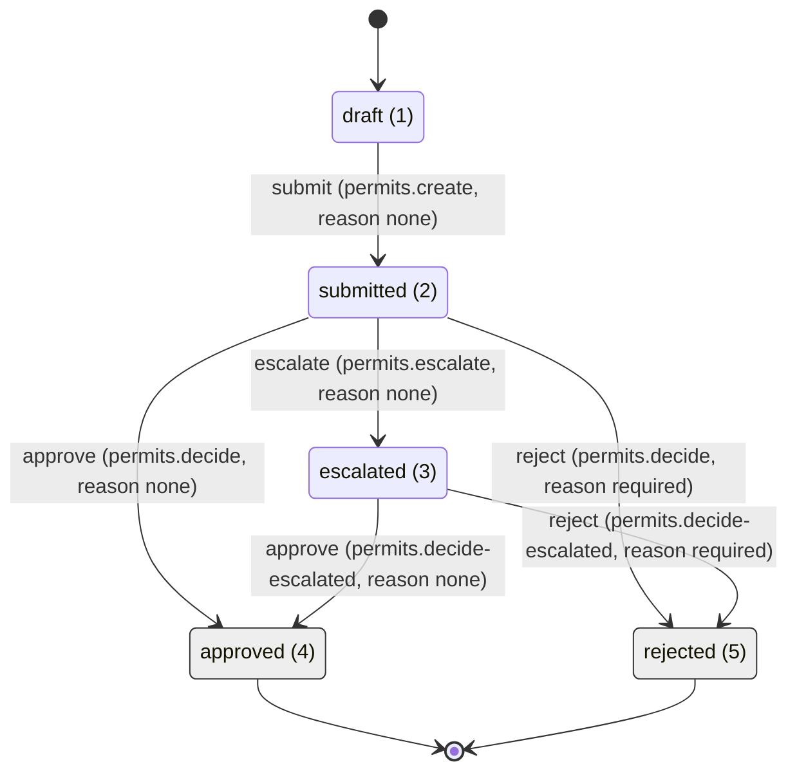

# Site-visit permit

## Scenario

> Clients request a site-visit permit; the inspector approves or rejects it with a reason; undecided after 5 days it
> escalates to the manager.

From the use-case workbook (sheet `Summary`, key facts): "Transitions: Submit, Approve, Reject, Escalate (system,
after 5 days undecided). Escalated permits are decided by the inspection manager. Notifications on every decision."

- **UC-PRM-01 Apply for a site-visit permit** (actor: client, entry point "Portal: Permits > New permit"). The client
  fills the site address, the visit type, the preferred visit date and the purpose, then submits. The permit becomes
  *Submitted* and gets a reference number shown to the client (BR-01, SC-01-01). A visit date less than 3 days after
  the submission date is refused (BR-02, SC-01-02); a missing mandatory field is refused with a field error (BR-03,
  SC-01-03).
- **UC-PRM-02 Decide a site-visit permit** (actor: inspector, entry point "Staff: Permits queue"). The inspector
  approves a *Submitted* permit (SC-02-01) or rejects it with a reason the client can read (BR-04, SC-02-02); a reject
  without a reason is refused and the permit stays *Submitted* (SC-02-03).
- **Escalation** (BR-05, SC-02-04): "A permit still Submitted 5 days after submission escalates to the inspection
  manager." The deadline is **5 calendar days** (gap G-01, resolved in the workbook: "calendar days"). The permit
  becomes *Escalated*; the inspection manager approves it or rejects it with a reason (SC-02-05).
- **Who decides** (BR-06): only inspectors decide *Submitted* permits; only the inspection manager decides *Escalated*
  permits. Clients see only their own permits; anyone else is refused (403) and does not see them (SC-02-06).
- **Bilingual** (BR-07): every screen and message exists in Arabic (RTL) and English.

### Open decisions (headless proof: each resolved by an assumption the approver may overturn)

| # | Question | Resolved as |
| --- | --- | --- |
| A-01 | The workbook starts at "(new)"; the record kernel needs one initial status that `submit` leaves. | A **Draft (1)** status, private to its owner, exactly like the sample. No cancel action (the workbook has none); an abandoned draft simply stays a draft. |
| A-02 | Working or calendar days? (G-01) | Calendar days (workbook resolution). The Deadlines module already counts wall-clock time, so no calendar port is needed. |
| A-03 | Due-soon warning before the 5-day deadline? The workbook is silent. | 1 day before (the sample's default), shown as the SLA badge in the queue and staff detail. |
| A-04 | How does the record move to *Escalated* automatically? The Deadlines module only **notifies** on a breach, and the Records module has **no system actor yet** (Records MODULE.md, Gotchas). | Use the Deadlines extension point "another reaction to a breach" (Deadlines MODULE.md (`backend/src/Modules/Deadlines/MODULE.md`), Extend): a kernel port called from `SlaEscalations.EscalateOneAsync` (claim-before-act kept), a system-actor transition entry point in Records, and a `Permits` implementation that runs `escalate` on a breached *Submitted* permit. No skill generates these: they are the expected hand edits (see Hand-edit log forecast). |
| A-05 | "Assigned to the inspection manager" (SC-02-04): the Assignments module cannot assign to another user yet (`IAssigneeEligibility` fails closed). | No automatic assignment. The inspection manager holds `permits.queue` + `assignments.work`, filters the queue by status *Escalated* and claims the permit. The escalate rule notifies the current assignee (the inspector, if one claimed it). |
| A-06 | "Manager notified" (SC-02-04): a transition can notify only the requester and/or the current assignee. | The manager is reached by the Deadlines escalation notification (`permits.sla-escalation`), which goes to the assignee, else to every queue-permission holder reaching the record's organization. Known limit: that fallback needs `IPermissionHolderDirectory`, which nothing implements yet (Deadlines MODULE.md, Gotchas); until the Access module provides it, an unclaimed breach reaches no one by notification, and the manager works from the queue's *Escalated* filter. Not built in this feature. |
| A-07 | Visit types: the workbook gives one example ("Safety inspection") and no list. | Lookup `permit-visit-types` with three values: `safety-inspection` (from the workbook), `maintenance-visit`, `survey-visit` (proposed). Arabic names are **proposed** wording (see Modules) for the i18n-keeper and the client to confirm; administrators can retire or add values later. |
| A-08 | Arabic wording for statuses, actions and notifications not written verbatim in the workbook. | Derived from the workbook's own Arabic sentences (مقدّم, معتمد, مرفوض, يُصعّد, تقديم, اعتماد, رفض); only "Draft" (مسودة) and the SLA escalation text are proposed. All marked in the tables below; i18n-keeper confirms. |
| A-09 | Attachments? The workbook names none. | No attachment types. The record type still registers its attachable key (recipe step 4) so attachments can be added later with the add-attachment-type recipe. |
| A-10 | Visit-date rule reference point. | "At least 3 calendar days after the submission date": checked on the step save and again on submit against **today** in the app time zone (`Numbering:TimeZoneId`), as the sample does for its preferred date; a draft saved early and submitted late is refused on submit. |
| A-11 | Wizard steps. | Two steps: 1 "Permit details" (site address, visit type, preferred visit date, purpose), 2 "Review and submit". |

## Inputs

- `tools/pipeline-proofs/inputs/permit/permit-use-cases.xlsx` (HLS format; read through its JSON source
  `tools/pipeline-proofs/inputs/permit/permit-use-cases.json`). Use cases **UC-PRM-01** and **UC-PRM-02**:
  - `Summary`: the two use cases, actors, entry points, terminal statuses (Submitted for UC-PRM-01; Approved,
    Rejected for UC-PRM-02) and the key facts.
  - `Functional`: scenarios SC-01-01..03 and SC-02-01..06 (become the Tests rows).
  - `Data`: the four wizard fields and the decision reason with their limits and en/ar errors (become the validation
    codes and their texts).
  - `BusinessRules`: BR-01..BR-07.
  - `StateTransitions`: the six transitions (become the table below).
  - `Gaps_Messages`: G-01 (resolved: calendar days) and the messages MSG-01..MSG-03 (become notification templates).
- The scenario sentence quoted in Scenario.
- No DGA screenshot or Figma frame: every screen follows its page pattern and the sample's screens; the visual check
  compares against pattern baselines in ar and en.

## Modules

**New module `Permits`** (`new-module`, then the add-workflow-type recipe (`docs/recipes/add-workflow-type.md`) steps 3
and 4, copying the `ServiceRequests` sample in and trimming it to this record type):

| Name | Value |
| --- | --- |
| Module | `Permits` (`backend/src/Modules/Permits`, `Starter.Modules.Permits`) |
| Entity | `Permit` (`PermitStatuses`, `PermitStatusKeys`, `PermitActions`, `PermitWorkflow`, `PermitRecord`) |
| Record type key | `permit` |
| Number prefix | `PRM` (numbers `PRM-2026-001`) |
| Permission prefix | `permits.*` |
| i18n prefix | `permits.*` |
| Frontend area | `features/permits` |
| Attachable record type | `permit` (no attachment types yet, A-09) |
| Schema / own table | `permits.Permits` |

Own data (`permits.Permits`, keyed by `RecordId` by value, no foreign key; every column nullable while a draft):

| Field | Column | Type | Rule (Data sheet) | Error codes (`PermitValidationCodes`) |
| --- | --- | --- | --- | --- |
| Site address | `SiteAddress` | text | required, 5 to 300 characters | `PERMITS_SITE_ADDRESS_REQUIRED`, `PERMITS_SITE_ADDRESS_TOO_SHORT`, `PERMITS_SITE_ADDRESS_TOO_LONG` |
| Visit type | `VisitTypeId` | lookup id (`permit-visit-types`) | required, one active value | `PERMITS_VISIT_TYPE_REQUIRED`, `PERMITS_VISIT_TYPE_UNKNOWN` |
| Preferred visit date | `PreferredVisitDate` | date | required, at least 3 days after the submission date (A-10) | `PERMITS_VISIT_DATE_REQUIRED`, `PERMITS_VISIT_DATE_INVALID`, `PERMITS_VISIT_DATE_TOO_SOON` |
| Purpose | `Purpose` | text | required, 1 to 500 characters | `PERMITS_PURPOSE_REQUIRED`, `PERMITS_PURPOSE_TOO_LONG` |

Plus `PERMITS_STEP_INVALID` (unknown wizard step) and `PERMITS_NOT_EDITABLE` (409, saving a submitted permit). Limits
are constants in `PermitLimits` (`SiteAddressMinLength` 5, `SiteAddressMaxLength` 300, `PurposeMaxLength` 500,
`VisitLeadDays` 3). The decision reason (1 to 1000) is the engine's: `WorkflowLimits.MaxReasonLength` is already 1000
and a blank required reason is `WORKFLOW_REASON_REQUIRED`.

Field error texts (from the Data sheet, en / ar):

| Code group | en | ar |
| --- | --- | --- |
| site address required | Site address is required. | عنوان الموقع مطلوب. |
| visit type required / unknown | Choose a visit type. | اختر نوع الزيارة. |
| visit date too soon | The visit date must be at least 3 days from today. | يجب أن يكون تاريخ الزيارة بعد 3 أيام على الأقل من اليوم. |
| purpose too long | Purpose is at most 500 characters. | الغرض 500 حرف على الأكثر. |
| reject reason required | A reason is required to reject. | السبب مطلوب عند الرفض. |

Site address too short / too long, visit date required / invalid and purpose required have no workbook wording:
ar: TBD, en: TBD (i18n-keeper writes them from the patterns above; open item for the client).

**Lookups** (seed migration only, `new-lookup`): lookup `permit-visit-types`, `LookupTypes.PermitVisitTypes`, ids
`PermitVisitTypeIds` in `Starter.Domain/Lookups`:

| Id | Code | en | ar |
| --- | --- | --- | --- |
| 1 | safety-inspection | Safety inspection | تفتيش السلامة (proposed, A-07) |
| 2 | maintenance-visit | Maintenance visit | زيارة صيانة (proposed, A-07) |
| 3 | survey-visit | Survey visit | زيارة مسح (proposed, A-07) |

Lookup type name: en "Permit visit types", ar "أنواع زيارات التصاريح" (proposed, A-07).

**Notifications** (seed migration only, add-notification recipe (`docs/recipes/add-notification.md`)): migration
`AddPermitTemplates`, keys in `PermitNotificationKeys`, InApp and Email, ar and en, placeholders `{{recordNumber}}`
(plus `{{reason}}` on rejected, `{{statusKey}}` and `{{dueAt}}` on the SLA escalation):

| Key | Source | en | ar |
| --- | --- | --- | --- |
| `permits.submitted` | MSG-01 | Your permit application {{recordNumber}} was submitted. | تم تقديم طلب التصريح {{recordNumber}}. |
| `permits.approved` | MSG-02 | Your permit {{recordNumber}} was approved. | تم اعتماد طلب التصريح {{recordNumber}}. |
| `permits.rejected` | MSG-03 | Your permit {{recordNumber}} was rejected. Reason: {{reason}} | تم رفض طلب التصريح {{recordNumber}}. السبب: {{reason}} |
| `permits.escalated` | SC-02-04 | Permit {{recordNumber}} was escalated to the inspection manager. | تم تصعيد طلب التصريح {{recordNumber}} إلى مدير التفتيش. (derived, A-08) |
| `permits.sla-escalation` | BR-05 | Permit {{recordNumber}} passed its decision deadline ({{dueAt}}). | تجاوز طلب التصريح {{recordNumber}} مهلة البت ({{dueAt}}). (proposed, A-08) |

**Changed outside `Permits`** (hand edits, A-04): `Starter.Application` (a new kernel port for a breach reaction),
`Deadlines` (`SlaEscalations.EscalateOneAsync` calls it), `Records` (a system-actor transition entry point). No other
module changes; `Assignments` is used as is.

## Statuses and transitions

| From | Action | To | Permission | Reason required |
| --- | --- | --- | --- | --- |
| draft (1) | submit | submitted (2) | permits.create | no |
| submitted (2) | approve | approved (4) | permits.decide | no |
| submitted (2) | reject | rejected (5) | permits.decide | yes |
| submitted (2) | escalate | escalated (3) | permits.escalate | no |
| escalated (3) | approve | approved (4) | permits.decide-escalated | no |
| escalated (3) | reject | rejected (5) | permits.decide-escalated | yes |

### Transition details

| From | Action | Side | Owner only | Reason | Reason field | Notification |
| --- | --- | --- | --- | --- | --- | --- |
| draft (1) | submit | requester | yes | none | - | permits.submitted to requester (MSG-01) |
| submitted (2) | approve | staff | no | none | - | permits.approved to requester (MSG-02) |
| submitted (2) | reject | staff | no | required | reason | permits.rejected to requester (MSG-03, with the reason) |
| submitted (2) | escalate | system | no | none | - | permits.escalated to assignee (A-05, A-06) |
| escalated (3) | approve | staff | no | none | - | permits.approved to requester (MSG-02) |
| escalated (3) | reject | staff | no | required | reason | permits.rejected to requester (MSG-03, with the reason) |

`escalate` is side `system`: never offered as a button, run only by the breach reaction (A-04). The engine refuses
staff rules to the record's owner (segregation of duties), so a client who also held a staff key still gets 403.
SC-02-06 (a client calling approve) is 403 `WORKFLOW_FORBIDDEN`.

### Statuses

| Value | Key | Initial | Terminal | en (requester; staff; admin) | ar |
| --- | --- | --- | --- | --- | --- |
| 1 | draft | yes | no | Draft | مسودة (proposed, A-08) |
| 2 | submitted | no | no | Submitted | مقدّم (from SC-01-01) |
| 3 | escalated | no | no | Escalated | مُصعّد (from SC-02-04) |
| 4 | approved | no | yes | Approved | معتمد (from SC-02-01) |
| 5 | rejected | no | yes | Rejected | مرفوض (from SC-02-02) |

One wording for all three audiences. Action labels: submit "Submit" / "تقديم", approve "Approve" / "اعتماد", reject
"Reject" / "رفض", escalate "Escalate" / "تصعيد" (derived from MSG-01..03 and SC-02-04, A-08). Wording keys
`permits.status.<statusKey>.<requester|staff|admin>`, labels `permits.action.<actionKey>`.

Catalog check (TransitionCatalogValidator): one initial status (draft); every status reachable (draft -> submitted ->
escalated / approved / rejected); no rule out of a terminal status; no action repeated from one status; both required
reasons have the field `reason`; every permission is in the Permissions table; every rule has a notification decision.

### Diagram

### new-transition runs (in order; every `--from` status exists before its run)

The draft (1) -> submitted (2) `submit` rule comes with the sample copy (Skill plan item 1). Then:

1. `--status escalated --status-en "Escalated" --status-ar "مُصعّد" --action escalate --from submitted --to escalated --permission permits.escalate --side system --reason none --label-en "Escalate" --label-ar "تصعيد" --notify assignee --template permits.escalated`
2. `--status approved --terminal --status-en "Approved" --status-ar "معتمد" --action approve --from submitted --to approved --permission permits.decide --side staff --reason none --label-en "Approve" --label-ar "اعتماد" --notify requester --template permits.approved`
3. `--status rejected --terminal --status-en "Rejected" --status-ar "مرفوض" --action reject --from submitted --to rejected --permission permits.decide --side staff --reason required --label-en "Reject" --label-ar "رفض" --notify requester --template permits.rejected`
4. `--action approve --from escalated --to approved --permission permits.decide-escalated --side staff --reason none --notify requester --template permits.approved`
5. `--action reject --from escalated --to rejected --permission permits.decide-escalated --side staff --reason required --notify requester --template permits.rejected`

## Deadlines

| Status | Duration | Due soon before | Escalation template |
| --- | --- | --- | --- |
| submitted (2) | 5 days (calendar, G-01) | 1 day (A-03) | permits.sla-escalation |

Declared as `PermitSlaPolicySource` (`ISlaPolicySource`, singleton) in `Permits` with `PermitSla.Submitted` = 5 days
and `PermitSla.SubmittedDueSoon` = 1 day (add-deadline recipe (`docs/recipes/add-deadline.md`)). The deadline opens when
the permit enters *Submitted* and closes when it leaves it (approve, reject or escalate). *Escalated* has no SLA (the
workbook gives none). On the breach the scan sends `permits.sla-escalation` and, through the breach-reaction extension
point (A-04, hand edits), runs `escalate` as the system actor; the reaction acts only when the record is still
*Submitted* and keeps the scan's claim-before-act rule.

## Permissions

| Key | Allows | Expected holder | Created by |
| --- | --- | --- | --- |
| permits.create | create, save and submit own draft permits (submit rule, owner only) | client | sample copy (renamed `create`) |
| permits.view-own | list and open own permits | client | sample copy (renamed `view-own`) |
| permits.queue | see the permits work queue and permit details (with `assignments.work`) | inspector, inspection manager | sample copy (renamed `queue`) |
| permits.decide | approve or reject a submitted permit | inspector | sample copy (renamed `decide`) |
| permits.decide-escalated | approve or reject an escalated permit | inspection manager | new-permission |
| permits.escalate | the system escalation on the 5-day breach | no role (system actor only) | new-permission |

The sample's `review` key (start-review) and the shell's default `permits.view` are not used by this flow and are
removed when the sample is merged into the shell (item 1). Descriptions for administrators (en; ar via i18n-keeper):
"Apply for a site-visit permit", "View own site-visit permits", "Work the site-visit permits queue", "Decide submitted
site-visit permits", "Decide escalated site-visit permits", "Escalate overdue site-visit permits (system)".

## Endpoints

| Method | Route | Permission | Request | Response |
| --- | --- | --- | --- | --- |
| POST | /api/permits | permits.create | none | 201 `{ id }` (a draft owned by the caller) |
| GET | /api/permits/{id}/draft | permits.create | none | `{ id, siteAddress, visitTypeId, preferredVisitDate, purpose }`; 404 `RECORDS_NOT_FOUND` |
| PUT | /api/permits/{id}/draft | permits.create | `{ siteAddress, visitTypeId, preferredVisitDate, purpose, step }` | 204; 400 `VALIDATION_FAILED`; 404; 409 `PERMITS_NOT_EDITABLE` |
| POST | /api/permits/{id}/submit | permits.create | none | 200 `{ number }`; 400 `VALIDATION_FAILED`; 409 `RECORDS_NOT_SUBMITTABLE`; 404 |
| GET | /api/permits/{id} | permits.view-own | none | `{ id, number, siteAddress, visitTypeId, visitTypeNameAr, visitTypeNameEn, preferredVisitDate, purpose }`; 404 |
| GET | /api/records/permit/{id} | authenticated (existing Records endpoint) | none | record detail with `allowedActions`, `lastReason`, `sla`, `assignee` |
| GET | /api/records/permit/{id}/timeline | authenticated (existing Records endpoint) | none | timeline rows |
| GET | /api/records/permit/mine | permits.view-own (existing Records endpoint, via registration) | `?status&page&pageSize` | own permits page |
| POST | /api/records/permit/{id}/transitions | per transition (table above; existing Records endpoint) | `{ action, reason }` | 200 the new detail; 400 `WORKFLOW_REASON_REQUIRED`; 403 `WORKFLOW_FORBIDDEN`; 409 `WORKFLOW_ACTION_NOT_ALLOWED` |
| GET | /api/queues/permit | permits.queue + assignments.work (existing Assignments endpoint) | `?view&status&number&page&pageSize` | queue page with `sla` |
| POST | /api/queues/permit/{id}/claim | permits.queue + assignments.work (existing Assignments endpoint) | none | 204 |
| GET | /api/lookups/permit-visit-types | authenticated (existing Lookups endpoint) | none | `[{ id, code, nameAr, nameEn, sortOrder }]` |

Only the first five are new (`new-endpoint`, root `PermitsRoutes.Root` = `/api/permits`). All ids are PublicId tokens
(Records family `records`); errors are problem+json. `GET /api/permits/{id}` is scaffolded with
`[HasPermission(permits.view-own)]` and then, like the sample, switched to `[AuthenticatedUser]` with the visibility
decided by `IRecordVisibility` (owner with view-own, or a `permits.queue` holder once submitted) plus its
`EndpointAllowlist` line, so the staff detail can read the fields (hand edit, forecast). The visit type travels as a
lookup PublicId token typed `string` (an `EndpointAllowlist.LookupTokenStringMembers` entry, hand edit, forecast).
Another client's permit answers 404 `RECORDS_NOT_FOUND` on reads and 403 on actions (BR-06).

## Screens

| Route | Page pattern | Permission | Target image |
| --- | --- | --- | --- |
| /permits | landing-dashboard | permits.view-own | none |
| /permits/new | wizard | permits.create | none |
| /permits/drafts/:id | wizard | permits.create | none |
| /permits/:id | requester-detail | permits.view-own | none |
| /staff/permits | work-queue | permits.queue | none |
| /staff/permits/:id | staff-detail | permits.queue | none |

- `/permits`: the requester's permits (own list from `GET /api/records/permit/mine`), with the "New permit" shortcut
  gated by `permits.create` (entry point "Portal: Permits > New permit").
- The wizard: step 1 the four fields (visit type from the lookup), step 2 review and submit; on success it shows
  MSG-01 and the reference number (BR-01). Client rules hand-mirrored in `features/permits/data/permit-rules.ts` with
  the parity fixture.
- Requester detail: status tracker, timeline, the fields and the rejection reason (`lastReason`).
- Work queue: views unassigned / mine / all, status filter (Submitted, Escalated), SLA badge.
- Staff detail: the fields, timeline, SLA badge and the decision panel rendering the server's `allowedActions`
  (approve, reject with the `app-decision-dialog` reason dialog). Buttons gated by `permits.decide` /
  `permits.decide-escalated`.
- Every string has ar and en keys under `permits.*`; routes registered with the `// codelab:module Permits` marker in
  `app.routes.ts` and `app-nav.ts`. No admin oversight screen (the generic Records oversight covers it).

## Rule files

- `backend/src/Modules/Permits/module.rules.yaml` (new-module): rules `permits.thin-endpoints`,
  `permits.data-through-ports`, `permits.workflow-in-the-catalog` (added by the first new-transition run),
  `permits.validation-parity`, `permits.one-access-rule`, `permits.no-module-reference` (merged from the sample's
  rules, renamed); recipes add-endpoint, add-permission, add-lookup, add-notification, add-deadline,
  add-workflow-type and the new-transition skill.
- `frontend/starter-web/src/app/features/permits/module.rules.yaml` (new-screen, first screen).
- `backend/src/Modules/Lookups/module.rules.yaml`: the add-lookup recipe is already listed (new-lookup adds it once).
- No change to `rules/base.rules.yaml`; no exemption.

## Tests

- **Backend unit** (`backend/tests/Modules/Starter.Modules.Permits.Tests`):
  - Use cases: create draft, save step (each field rule), submit (SC-01-01 gets a number, SC-01-02 visit date too
    soon, SC-01-03 missing site address), get detail (owner, staff, another client refused).
  - Validators: `PermitRules` boundaries (site address 4/5/300/301, purpose 0/1/500/501, visit date today+2 / today+3)
    and `PermitSubmitValidator`; `ValidationParityTests` on the shared fixture.
  - Workflow (`TransitionFixture`, one class per rule from new-transition, plus `PermitWorkflowTests` for the whole
    table): SC-02-01 approve, SC-02-02 reject with reason, SC-02-03 reject without reason refused, SC-02-05 manager
    approve and reject from Escalated, SC-02-06 client approve refused (403), inspector refused on Escalated, manager
    refused on Submitted, `escalate` not offered to any person, terminal statuses offer nothing;
    `TransitionCatalogValidator.Validate` empty.
  - SLA: `PermitSlaPolicySource` (record type `permit`, status submitted, 5 days, 1 day, `permits.sla-escalation`).
  - Breach reaction: escalates a breached Submitted permit once, does nothing when it already left Submitted.
  - Seeds: lookup migration equals `PermitVisitTypeIds` (new-lookup test); template migration has every
    `PermitNotificationKeys` key in ar and en on InApp and Email with only the allowed placeholders.
- **Deadlines and Records unit tests** for the hand edits: the scan calls every registered breach reaction after the
  claim and once per breach; the system-actor transition refuses a non-system rule.
- **Contract and architecture**: Starter.Contract.Tests (every endpoint gated, PublicId, workflow permissions and
  wording) and Starter.Architecture.Tests (no module reference) stay green.
- **Integration** (`Starter.Integration.Tests/Deadlines` pattern, SC-02-04): submit a permit, advance `TimeProvider`
  5 days, run `deadlines-sla-scan`: the permit is *Escalated*, one escalation notification row, still one after a
  second run. HTTP tests for the five typed endpoints (sample's `Http/` pattern).
- **Frontend** (Vitest, `features/permits`): each page component and store, `permit-rules` and the parity spec, route
  gates spec; visual check ar and en at 1440 and 390 with 0 serious or critical axe violations.

## Docs

- New `backend/src/Modules/Permits/MODULE.md` (Purpose, Use, Extend, Rules, Gotchas; the breach reaction and A-05/A-06
  limits as Gotchas) and `frontend/starter-web/src/app/features/permits/MODULE.md`; its row in
  `frontend/starter-web/MODULE.md`.
- Updated: `backend/src/Modules/Deadlines/MODULE.md` (the breach-reaction port now exists, Use and Extend),
  `backend/src/Modules/Records/MODULE.md` (the system-actor entry point replaces the "No system actor yet" gotcha),
  `backend/src/Starter.Application/MODULE.md` (the new kernel port), `backend/src/Modules/Lookups/MODULE.md` (seeded
  types row, by new-lookup), `docs/recipes/add-deadline.md` (how to make a breach change the status).
- Regenerated (never hand-edited): `docs/generated/workflows/permit.md` (the sign-off sheet; must match the diagram
  above), `docs/generated/statuses.md`, `docs/generated/permissions.md`, `docs/generated/endpoints.md`,
  `docs/generated/error-codes.md`, `docs/generated/openapi.v1.json`; nested `CLAUDE.md` files by the rules compile.

## Skill plan

1. new-module - `node tools/scaffold/new-module.mjs --name Permits`, then add-workflow-type recipe steps 3 and 4: copy
   the `ServiceRequests` Domain, Application (workflow, drafts, validation, engine sources) and Infrastructure in,
   rename (`ServiceRequest` -> `Permit`, `service-request` -> `permit`, `serviceRequests` -> `permits`, `SR` -> `PRM`),
   replace the fields with the four of this spec (`InitialCreate` in schema `permits`), keep the permission keys
   `create`, `view-own`, `queue`, `decide` (drop `review` and the shell's `view`), and trim the workflow to draft (1)
   -> submitted (2) `submit` (template `permits.submitted`). The copied Api controller is not kept (item 8 onwards).
2. new-permission - `--module Permits --action decide-escalated --description "Decide escalated site-visit permits"`.
3. new-permission - `--module Permits --action escalate --description "Escalate overdue site-visit permits (system)"`.
4. new-transition - run 1 of "new-transition runs": status escalated (3) and `escalate` from submitted (system).
5. new-transition - runs 2 to 5: approved (4) and rejected (5) from submitted (permits.decide), then approve and reject
   from escalated (permits.decide-escalated); then the `AddPermitTemplates` Notifications migration for
   `permits.submitted`, `.approved`, `.rejected`, `.escalated` (add-notification recipe).
6. deadline-recipe - `PermitSlaPolicySource`: submitted, 5 days, due soon 1 day, template `permits.sla-escalation`
   (added to `AddPermitTemplates`); then the breach reaction through the Deadlines extension point (hand edits, A-04).
7. new-lookup - `--type permit-visit-types --name PermitVisitTypes --codes safety-inspection,maintenance-visit,survey-visit --name-en "Permit visit types" --name-ar "أنواع زيارات التصاريح" --names-en "Safety inspection;Maintenance visit;Survey visit" --names-ar "تفتيش السلامة;زيارة صيانة;زيارة مسح"`.
8. new-endpoint - `--module Permits --name CreatePermitDraft --method POST --route "" --permission permits.create`.
9. new-endpoint - `--module Permits --name GetPermitDraft --method GET --route "{id}/draft" --permission permits.create`.
10. new-endpoint - `--module Permits --name SavePermitDraft --method PUT --route "{id}/draft" --permission permits.create`.
11. new-endpoint - `--module Permits --name SubmitPermit --method POST --route "{id}/submit" --permission permits.create`.
12. new-endpoint - `--module Permits --name GetPermit --method GET --route "{id}" --permission permits.view-own` (then
    `[AuthenticatedUser]` + allowlist, hand edit).
13. new-screen - `/permits` landing-dashboard (requester permits and the New permit shortcut).
14. new-screen - `/permits/new` and `/permits/drafts/:id` wizard (two steps, parity fixture).
15. new-screen - `/permits/:id` requester-detail.
16. new-screen - `/staff/permits` work-queue.
17. new-screen - `/staff/permits/:id` staff-detail with the decision dialog.

## Hand-edit log

| # | File | Reason |
| --- | --- | --- |
| 1 | `backend/src/Starter.Application/Records/ISlaBreachReaction.cs`, `IRecordSystemTransitions.cs` (new), `IRecordTransitionObserver.cs` (doc: `ActorUserId` is 0 for the system actor) | A-04: the kernel ports for "another reaction to a breach" and a system-actor transition; no skill creates a kernel port. |
| 2 | `backend/src/Modules/Deadlines/Application/SlaEscalations.cs` | A-04: the scan calls every `ISlaBreachReaction` after the claim (also when nobody is notified; not after a given-back claim), each isolated; the SLA definition lookup moved into `BreachLoader` to stay within the 5-parameter limit. No skill edits Deadlines. |
| 3 | `backend/src/Modules/Records/Application/RecordSystemTransitions.cs` (new), `RecordStanding.cs`, `RecordCommits.cs`, `Infrastructure/RecordsModuleRegistration.cs` | A-04: the system-actor entry point (`RecordCaller.System`, timeline row with no user id, only system-side rules); Records had no system actor. |
| 4 | `backend/src/Modules/Permits/Application/Workflow/PermitEscalationOnBreach.cs` (new) | A-04: the Permits reaction that runs `escalate` on a breached Submitted permit; the deadline recipe has no breach-reaction step. |
| 5 | `backend/src/Modules/Permits/Infrastructure/PermitsModuleRegistration.cs` | A-04: registers the reaction (`ISlaBreachReaction`); the recipe registers only the SLA source. |
| 6 | `backend/src/Modules/Permits/Api/*Controller.cs` (the five generated controllers), `Api/PermitsRoutes.cs`, `Api/PermitsResults.cs` (new) | Spec routes: `new-endpoint` refuses `--route ""` and `--route "{id}/draft"` (only kebab segments, id always last), so it ran with `draft`, `submit` and `details` and the route templates were set to `/api/permits`, `{id}/draft`, `{id}/submit` and `{id}`; plus the 201 mapping of the create endpoint (sample's `ServiceRequestsResults`). The generated use cases, stores and tests were then filled in (business logic, not counted). |
| 7 | `backend/tests/Modules/Starter.Modules.Permits.Tests/Workflow/EscalateFromSubmittedTransitionTests.cs` | Fix to generated scaffolding: `new-transition --side system` emits a stub that takes the rule from the staff side (`TransitionFixture` default), which the engine refuses; the stub now acts `OnSide(TransitionSide.System)`. |
| 8 | `frontend/starter-web/src/app/app.spec.ts` | Screens (items 13-17): the app spec pins the staff shell's exact children list, so mounting `PERMITS_ROUTES` in `SHELL_ROUTE` (the new-screen route step) needs one marked line there (`...PERMITS_ROUTES.map(child => child.path), // codelab:module Permits`) plus its import; the skill names `app.routes.ts` but not this spec. |

### Notes (backend-builder; not log rows)

- Backend total: 7 hand edits (forecast 8). Forecast rows 6 to 8 were avoided: `GET /api/permits/{id}` keeps
  `[HasPermission(permits.view-own)]` (visibility still decided by `IRecordVisibility`), and the visit type travels as a
  typed `PublicId<PermitVisitTypeTokens>` (family `lookup-items`), so `EndpointAllowlist.cs` (platform-owned) is
  untouched. Consequence: a staff role that should read `GET /api/permits/{id}` must also hold `permits.view-own`;
  switching to `[AuthenticatedUser]` later needs the platform owner's allowlist line (Permits MODULE.md, Gotchas).
- Not counted (recipe steps or docs the spec asks for): the sample copy and rename (add-workflow-type steps 3 and 4,
  including `AttachableRecordTypes.Permit`, the shell's `PermitsIds` merged with the sample's record-family label
  `records`, the test project references, and the `draft`/`submitted`/`submit` ar and en keys of the copied catalog);
  the `AddPermitTemplates` migration with the Notifications model test list (add-notification recipe); the SLA source
  and its registration (add-deadline recipe); MODULE.md updates (Permits, Deadlines, Records, Starter.Application,
  Notifications) and `docs/recipes/add-deadline.md` step 4b.
- Deviations: the generators ran with `--skip-generate` / `--no-gen`; the rules compile, DocsGen and api:gen ran once at
  the end. The new-lookup ids class is `PermitVisitTypesIds` (generator naming) and the limits class the shell's
  `PermitsLimits`, not `PermitVisitTypeIds` / `PermitLimits` as written above. The generated per-use-case store ports
  (`I<UseCase>Store`) are kept and implemented (shell deletes of the placeholder files are refused by the hook).

### Notes (screen-builder; not log rows)

- Frontend total: 1 hand edit (row 8). Not counted (new-screen skill output): `features/permits/**` (module.rules.yaml,
  MODULE.md, pages, stores, data layer, the parity fixture and specs), `RoutePaths.Permits` / `RoutePaths.StaffPermits`
  in `core/routing/route-paths.ts` (skill step 2), the `// codelab:module Permits` lines in `app.routes.ts` and
  `app-nav.ts`, the `permits.*` ar/en keys (skill step 5), the area row in `frontend/starter-web/MODULE.md` (step 7), and
  the rules compile output (nested `CLAUDE.md`, `rules/*.compiled.json`).
- The backend has no `ValidationParityTests` in `Starter.Modules.Permits.Tests` yet: the FE fixture
  `features/permits/data/validation-parity.fixtures.json` (scopes `step1` = `PermitValidationScope.DetailsStep`,
  `submit`) is ready for it; only the FE half runs today.
- All screens mount in the staff shell (the requester shell claims only `/service-requests`), see
  `features/permits/MODULE.md`, Gotchas.

## Review log

Iterations: 0
