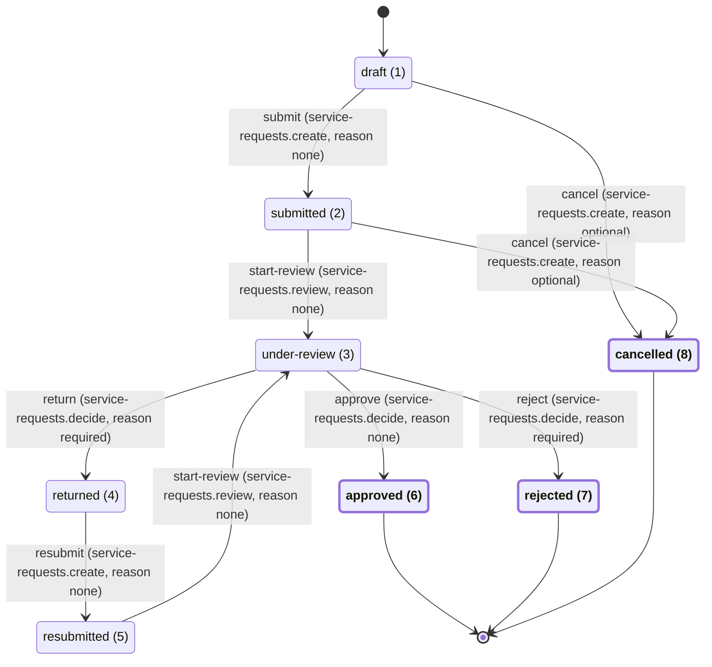

# Workflow: service-request

> Generated by `backend/tools/Starter.DocsGen`. Do not edit; regenerate with `dotnet run --project backend/tools/Starter.DocsGen -- --out docs/generated`.

The workflow of the `service-request` record type, declared by ServiceRequests in `Starter.Modules.ServiceRequests.Application.Workflow.ServiceRequestWorkflowDefinition`.

## Diagram

Each arrow is one transition rule: the action, the permission the actor must hold and whether a reason is asked for. `[*]` marks where a record starts and where it ends; terminal statuses are bold and offer no action.

## Statuses

| Value | Key | Initial | Terminal | Requester wording | Staff wording | Admin wording |
| --- | --- | --- | --- | --- | --- | --- |
| 1 | `draft` | yes |  | `serviceRequests.status.draft.requester` | `serviceRequests.status.draft.staff` | `serviceRequests.status.draft.admin` |
| 2 | `submitted` |  |  | `serviceRequests.status.submitted.requester` | `serviceRequests.status.submitted.staff` | `serviceRequests.status.submitted.admin` |
| 3 | `under-review` |  |  | `serviceRequests.status.under-review.requester` | `serviceRequests.status.under-review.staff` | `serviceRequests.status.under-review.admin` |
| 4 | `returned` |  |  | `serviceRequests.status.returned.requester` | `serviceRequests.status.returned.staff` | `serviceRequests.status.returned.admin` |
| 5 | `resubmitted` |  |  | `serviceRequests.status.resubmitted.requester` | `serviceRequests.status.resubmitted.staff` | `serviceRequests.status.resubmitted.admin` |
| 6 | `approved` |  | yes | `serviceRequests.status.approved.requester` | `serviceRequests.status.approved.staff` | `serviceRequests.status.approved.admin` |
| 7 | `rejected` |  | yes | `serviceRequests.status.rejected.requester` | `serviceRequests.status.rejected.staff` | `serviceRequests.status.rejected.admin` |
| 8 | `cancelled` |  | yes | `serviceRequests.status.cancelled.requester` | `serviceRequests.status.cancelled.staff` | `serviceRequests.status.cancelled.admin` |

## Transitions

Allowed actions are computed on the server from this table (side, permission, ownership and status); screens never hard-code them. A required reason is refused when blank.

| Action | From | To | Side | Permission | Owner only | Reason | Reason field | Label key | Notification |
| --- | --- | --- | --- | --- | --- | --- | --- | --- | --- |
| `submit` | `draft` (1) | `submitted` (2) | requester | `service-requests.create` | yes | none |  | `serviceRequests.action.submit` | `service-requests.submitted` to requester |
| `cancel` | `draft` (1) | `cancelled` (8) | requester | `service-requests.create` | yes | optional | `reason` | `serviceRequests.action.cancel` | nobody (on purpose) |
| `start-review` | `submitted` (2) | `under-review` (3) | staff | `service-requests.review` |  | none |  | `serviceRequests.action.start-review` | `service-requests.under-review` to requester |
| `cancel` | `submitted` (2) | `cancelled` (8) | requester | `service-requests.create` | yes | optional | `reason` | `serviceRequests.action.cancel` | `service-requests.cancelled` to requester, assignee |
| `return` | `under-review` (3) | `returned` (4) | staff | `service-requests.decide` |  | required | `reason` | `serviceRequests.action.return` | `service-requests.returned` to requester |
| `approve` | `under-review` (3) | `approved` (6) | staff | `service-requests.decide` |  | none |  | `serviceRequests.action.approve` | `service-requests.approved` to requester |
| `reject` | `under-review` (3) | `rejected` (7) | staff | `service-requests.decide` |  | required | `reason` | `serviceRequests.action.reject` | `service-requests.rejected` to requester |
| `resubmit` | `returned` (4) | `resubmitted` (5) | requester | `service-requests.create` | yes | none |  | `serviceRequests.action.resubmit` | `service-requests.resubmitted` to assignee |
| `start-review` | `resubmitted` (5) | `under-review` (3) | staff | `service-requests.review` |  | none |  | `serviceRequests.action.start-review` | `service-requests.under-review` to requester |
